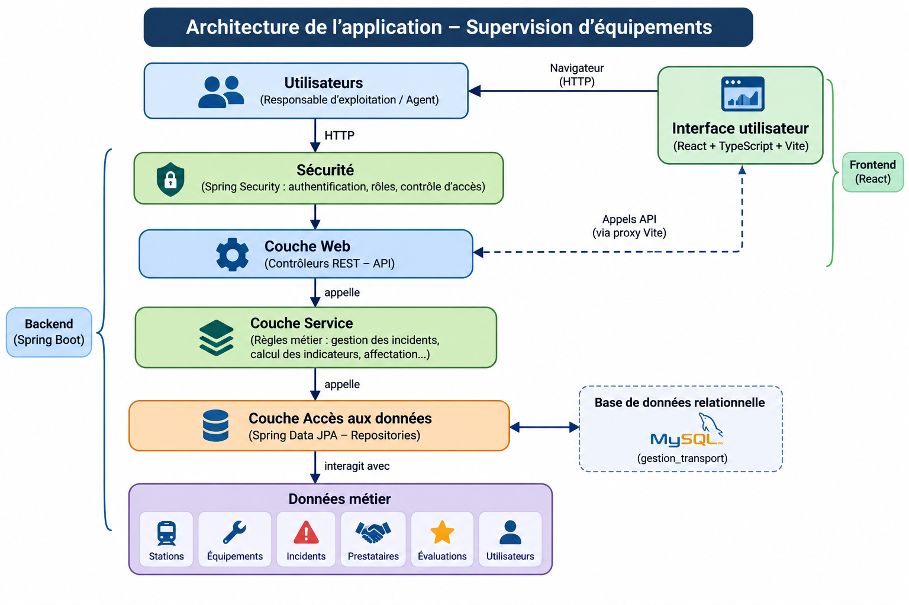

# Journal — Dashboard RATP (ALTN72, 2026-27)

**Groupe :** Daria CHEMLOUL, Paul BALAINE

## README

- Prérequis : Java 27, Maven 3.9.16, base MySQL Server, projet front : Node.js 20.19, React 19, TypeScript 6 et Vite 8
- Initialiser la base : `src\main\resources\script_creation_BDD.sql.` (création de la base) et `src\main\resources\script_insertion_BDD.sql` (insérer les données)
- Lancer : Projet (Projet-final-Java-Fullstack) : `mvn spring-boot:run` , Projet (projet-fullstack-web-frontend-S7) : `npm run dev`
- Application déployée : https://projet-fullstack-web-frontend-s7.onrender.com/
- Comptes de test : profil 1 : "agent1" / "password" ; profil 2 : "resp.expl1" / "password"
- Limites connues : Aucune limitation connue

## ARCHITECTURE

- Dépôt :
  - url du dépot backend : https://github.com/itismepol/Projet-final_Full-stack-java-S7.git
  - url du dépot frontend : https://github.com/DrDriia/projet-fullstack-web-frontend-S7.git

- Schéma : 

## TESTS

- Stratégie :
  Nous avons principalement utilisé JUnit 5 et Mockito pour tester notre backend. Notre stratégie repose sur deux types de tests complémentaires : les tests unitaires de la couche Service et les tests des contrôleurs.

  Les tests des services permettent de vérifier le bon fonctionnement des règles métier indépendamment de la base de données. Nous simulons les repositories avec Mockito afin de contrôler les données utilisées et de vérifier les comportements attendus, notamment la gestion du cycle de vie des incidents, les affectations, les évaluations et le calcul des niveaux d'urgence.

  Pour les contrôleurs, nous utilisons `@WebMvcTest` et `MockMvc`. Ces outils permettent de simuler des requêtes HTTP et de vérifier les réponses de l'API : codes HTTP, messages d'erreur, validations des données et restrictions d'accès selon les profils.

- Commande : `mvn verify`
- Couvert :
  - La création, l'affectation et la résolution des incidents.
  - Les règles empêchant certaines opérations interdites, comme l'évaluation d'un incident non résolu.
  - Le calcul des indicateurs d'urgence, notamment les seuils de 48 h et 72 h.
  - Le fonctionnement du tableau de bord et le calcul de ses indicateurs.
  - La gestion des ressources inexistantes et des listes vides.
  - Les restrictions d'accès selon les profils Agent et Responsable d'exploitation.
  - La validation des données reçues par l'API et la gestion des erreurs HTTP.
  - La protection CSRF des requêtes qui modifient les données.

- Non couvert et limites

  Nos tests actuels se concentrent principalement sur les couches Service et Controller. Les repositories sont simulés avec Mockito : nous ne vérifions donc pas directement l'exécution des requêtes SQL ou JPQL sur une véritable base de données.

  La connexion réelle à MySQL et le fonctionnement de bout en bout de l'application ne sont pas couverts par les tests. Il faudrait mettre en place des tests d'intégration avec Spring Boot et une base MySQL pour vérifier la communication entre les différentes couches.

  De même, l'atomicité des opérations utilisant `@Transactional` n'est pas directement testée. Spring gère automatiquement les transactions, mais un test spécifique serait nécessaire pour provoquer une erreur au cours d'une opération et vérifier que toutes les modifications sont annulées.

  Enfin, l'authentification est testée de manière partielle : les profils sont simulés avec `@WithMockUser`, mais le parcours complet de connexion avec les identifiants, le mot de passe et la session n'est pas vérifié.

  Ces limites constituent des pistes d'amélioration pour renforcer la fiabilité de l'application avec des tests d'intégration et des tests de bout en bout.

## CHOIX TECHNIQUES

- Droits par profil :

  | N°    | Fonctionnalité                        | Profil 1 : RESPONSABLE_EXPLOITATION | Profil 2 : AGENT |
  | ----- | ------------------------------------- | ----------------------------------- | ---------------- |
  | F2–F3 | Consulter équipements et fiches       | Lecture seule                       | Lecture seule    |
  | F4    | Déclarer un incident                  | Accès complet                       | Accès complet    |
  | F5    | Consulter un incident                 | Accès complet                       | Lecture seule    |
  | F6    | Modifier un incident                  | Accès complet                       | Interdit         |
  | F7    | Affecter ou réaffecter un prestataire | Accès complet                       | Interdit         |
  | F8    | Déclarer un incident résolu           | Accès complet                       | Interdit         |
  | F9    | Consulter l'historique                | Accès complet                       | Lecture seule    |
  | F10   | Évaluer un prestataire                | Accès complet                       | Interdit         |
  | F11   | Tableau de bord                       | Accès complet                       | Interdit         |

- Exceptions : @ControllerAdvice (GestionnaireExceptions.java)

  Au lieu de gérer les exceptions dans chaque contrôleur, on les intercepte dans une classe dédiée.
  Avantages :
  - Toutes les exceptions sont traitées dans une seule classe.
  - Évite la duplication.
  - Les erreurs renvoient des réponses avec des codes HTTP et des messages compréhensibles.
  - Maintenance facilitée grâce à la centralisation.
  - Séparation des responsabilités.

- SOLID :
- 1. SRP – Single Responsibility Principle (principe de responsabilité unique)\*\*

  Nous avons appliqué ce principe en séparant notre application en plusieurs couches ayant chacune une responsabilité précise :
  - Les contrôleurs gèrent les requêtes HTTP et les réponses de l'API.
  - Les services contiennent les règles métier et les traitements de l'application.
  - Les repositories sont responsables de l'accès aux données.
  - Les entités représentent les objets métier et leurs relations.

  Cette séparation permet de mieux organiser le code, de faciliter sa maintenance et de limiter les modifications à une seule partie de l'application lorsqu'un besoin évolue.

- 2. DIP – Dependency Inversion Principle (principe d'inversion des dépendances)\*\*

  Nous appliquons également ce principe grâce à l'injection de dépendances proposée par Spring. Par exemple, les services utilisent les repositories à travers leurs interfaces, sans avoir à créer directement leurs instances.

  Nous privilégions l'injection par constructeur, ce qui rend les dépendances explicites et facilite les tests unitaires en permettant de remplacer les repositories par des objets simulés avec Mockito.

- Principes non appliqués ou non identifiés
  - OCP – Open/Closed Principle (principe ouvert/fermé)\*\*

  Nous n'avons pas mis en place de mécanisme particulier reposant sur ce principe. Notre application possède des fonctionnalités relativement ciblées et nous n'avons pas identifié de besoin nécessitant une architecture extensible par ajout de nouvelles implémentations sans modifier le code existant.
  - LSP – Liskov Substitution Principle (principe de substitution de Liskov)\*\*

  Nous n'avons pas identifié de situation nécessitant une hiérarchie d'héritage polymorphique particulière. Notre modèle repose principalement sur des entités métier et des associations entre celles-ci. L'application de ce principe n'aurait donc pas apporté de bénéfice concret à notre conception actuelle.
  - ISP – Interface Segregation Principle (principe de ségrégation des interfaces)\*\*

  Nous n'avons pas eu besoin de créer plusieurs interfaces spécialisées pour séparer les responsabilités d'un même contrat. Les interfaces utilisées, notamment celles des repositories, répondent aux besoins actuels de l'application. Une séparation supplémentaire aurait complexifié inutilement le projet.

- Requête SQL native :

  ```java
  @Query("SELECT i FROM Incident i WHERE i.statut = altn72.prj.modele.IncidentStatut.RESOLU AND i.equipement.station.id = :idStation ORDER BY i.dateResolution DESC")
  @Query("SELECT i FROM Incident i WHERE i.statut = altn72.prj.modele.IncidentStatut.RESOLU AND i.equipement.id = :idEquipment ORDER BY i.dateResolution DESC")
  @Query("SELECT i FROM Incident i WHERE i.statut <> altn72.prj.modele.IncidentStatut.RESOLU AND i.equipement.id = :idEquipment ORDER BY i.dateOuverture")
  @Query("SELECT i FROM Incident i WHERE i.prestataire.id = :idPrestataire " + "AND EXISTS (SELECT e FROM Evaluation e WHERE e.incident = i) "+ "ORDER BY i.dateResolution DESC")
  ```

- @Transactional :

  Nous utilisons l'annotation `@Transactional` dans la couche Service afin de garantir l'atomicité des opérations métier qui impliquent plusieurs modifications en base de données. Elle permet de s'assurer qu'une opération est entièrement réalisée ou que ses modifications sont annulées en cas d'erreur.

  Nous avons également utilisé cette annotation dans le suivi des connexions afin d'encadrer la mise à jour de la date de dernière connexion d'un utilisateur.

  Nous avons choisi de ne pas l'ajouter systématiquement à toutes les méthodes, mais uniquement lorsque son utilisation apporte une réelle garantie de cohérence des données.

## LOT ALPHA

### Fonctionnalité transverse 1 : Supervision avancée

    - **Besoin :** permettre au responsable d’exploitation de repérer rapidement les incidents actifs qui nécessitent une intervention prioritaire et de suivre leur évolution.
    - **Périmètre envisagé :** afficher les incidents ouverts ou affectés, des indicateurs synthétiques, leur ancienneté et leur niveau d’attention. La recherche multicritère, les filtres combinables, les vues personnalisées et l’analyse temporelle complètent l’objectif de supervision.
    - **Choix et essais :** exposer les données via un endpoint REST `GET /dashboard`, réservé au rôle `RESPONSABLE_EXPLOITATION`. Le service rassemble les incidents et calcule les indicateurs ; les tests vérifient notamment les résultats sans incident, les compteurs, les niveaux d’attention et les informations du prestataire.
    - **Ce qui fonctionne :** le tableau de bord renvoie les incidents, triés par date d’ouverture, ainsi que leur durée, leur statut, leur équipement, leur station et leur prestataire. Il fournit le nombre total d’incidents actifs, le nombre d’incidents en attente d’affectation ou affectés, ainsi que les nombres d’incidents urgents et de priorité critique. Pour les incidents non affectés, le niveau d’attention passe à orange après 48 heures et à rouge après 72 heures.
    - **Difficultés :** mettre en place le trie et la recherche multicritère.
    - **Reste à faire :** l’API du backend renvoie actuellement la liste complète des incidents actifs avec un tri fixe. Il reste à ajouter côté API les critères de recherche et les tris dynamiques.

### Fonctionnalité transverse 2 : Interface enrichie par l’API REST

2. **Interface enrichie par l’API REST**
   - **Besoin :** proposer une interface qui permet aux utilisateurs de consulter et de gérer les données de l’application sans accéder directement à la base de données.
   - **Périmètre envisagé :** relier le frontend React/TypeScript au backend Spring Boot pour consulter les stations, les équipements, les incidents et les prestataires, et effectuer les actions prévues selon le profil de l’utilisateur.
   - **Choix et essais :** séparer l’interface et la logique métier en deux applications qui communiquent par des endpoints REST HTTP. Le frontend envoie des requêtes à l’API et exploite les réponses pour afficher ou mettre à jour les informations. Les routes du backend couvrent notamment la consultation des ressources, la création d’incidents, leur résolution, leur affectation à un prestataire et leur évaluation.
   - **Ce qui fonctionne :** le backend expose des endpoints REST pour consulter les stations, équipements, incidents, prestataires et tableau de bord. Il permet également de créer un incident, de consulter l’historique et, pour les actions autorisées, de résoudre un incident, de lui affecter un prestataire ou de saisir une évaluation. Les droits sur certaines actions sont contrôlés par rôle.
   - **Difficultés :** intégrer deux applications développées séparément et assurer la cohérence entre les routes, les données échangées et les actions disponibles selon les droits de l’utilisateur.
   - **Reste à faire :** aucun reste fonctionnel précis. Il reste à maintenir la cohérence entre le frontend et l’API lors de toute évolution, puis à vérifier leur intégration dans l’environnement de déploiement.

## BILAN

- Contribution de chacun :

  La contribution de chacun a été relativement équilibrée tout au long du projet. Dans un premier temps, nous avons réparti le travail en attribuant le développement du backend à l'un et celui du frontend à l'autre.

  Par la suite, lors de l'intégration des deux parties, nous avons fait évoluer cette organisation pour nous concentrer davantage sur le développement des fonctionnalités, leur mise en commun et le débogage.

  Ainsi, même si nous avions initialement des responsabilités distinctes, nous avons tous les deux participé à l'ensemble du projet, aussi bien au développement qu'à l'intégration et à la résolution des problèmes.
  - Plus grande difficulté et comment elle a été surmontée :

  Le deploiement nous a posé une grande difficulté. On a pu surmontée cette difficulté grâce la lecture et l'analyse des logs. De plus, l'IA nous a été d'une grande d'aide car elle nous a permis d'identifier des points d'incohérences dans notre code lié par exemple avec la gestion du CORS.

- Fonctionnalités non réalisées et pourquoi :

  Toutes les fonctionnalités ont été réalisées.

- Trois points à retenir du cours et du projet :
  1. **L'une architecture Full Stack :** ce projet nous a permis de mettre en pratique nos connaissances en développant une application complète, avec un backend en Java / Spring Boot et un frontend en React / TypeScript, reliés à une base de données relationnelle.

  2. **La gestion des règles métier et des fonctionnalités :** nous avons appris à traduire des besoins fonctionnels en fonctionnalités concrètes, notamment la gestion des incidents, leur affectation, le suivi de leur urgence et la création d'un tableau de bord.

  3. **Le travail en équipe et l'intégration :** nous avons appris à répartir le travail, à faire communiquer deux parties développées séparément et à résoudre ensemble les problèmes rencontrés lors de leur intégration. Cette collaboration nous a permis de participer à l'ensemble du projet.

## Évolution séance finale

### Description de l'évolution réalisée

Nous avons ajouté une fonctionnalité permettant d'identifier les équipements fragiles, c'est-à-dire les équipements ayant enregistré au moins trois incidents au cours des trente derniers jours.

Cette évolution concerne principalement les fichiers suivants :

**Backend :**

- `IncidentRepository.java` : ajout d'une méthode permettant de compter les incidents d'un équipement à partir d'une date donnée.
- `EquipementFragileService.java` : création d'un service chargé de calculer si un équipement est fragile.
- `Equipement.java` : ajout d'une propriété calculée `fragile`, non persistée en base de données.
- `ConsultationEquipementService.java` : calcul de la fragilité lors de la consultation d'un équipement.
- `DashboardIncidentDto.java` et `DashboardService.java` : ajout de l'information de fragilité dans les données du tableau de bord.
- `IncidentService.java` : recalcul de la fragilité après la déclaration d'un incident.

**Frontend :**

- `src/utils/types/equipement.ts` et `src/utils/types/dashboard.ts` : ajout des propriétés nécessaires dans les types TypeScript.
- `src/components/pages/EquipementDetailsPage.tsx` : affichage du badge « Équipement fragile » sur la fiche équipement.
- `src/components/pages/DashboardPage.tsx` : affichage du badge sur les incidents actifs associés à un équipement fragile.
- `src/components/forms/IncidentForm.tsx` : adaptation du message de confirmation après la déclaration d'un incident.

### Choix de conception et raccourcis éventuels

Nous avons choisi de ne pas enregistrer le caractère fragile dans la base de données. Il est calculé à chaque consultation à partir des dates d'ouverture des incidents associés à l'équipement.

La règle métier est placée dans un service dédié, `EquipementFragileService`, afin de respecter la séparation des responsabilités entre les repositories, les services et les contrôleurs.

Le seuil de trois incidents et la période de trente jours sont regroupés sous forme de constantes dans ce service. Cela évite de disperser ces valeurs dans plusieurs parties du code.

Le comptage prend en compte tous les incidents, quel que soit leur statut. La date limite est incluse dans le calcul : un incident ouvert exactement trente jours auparavant est donc comptabilisé.

Nous avons utilisé une méthode de comptage Spring Data JPA plutôt que de récupérer tous les incidents pour effectuer le calcul en Java. Cela permet de confier le comptage à la base de données.

### Tests ajoutés et limites connues

Nous avons ajouté des tests unitaires avec JUnit 5 et Mockito pour vérifier :

- Qu'un équipement ayant deux incidents récents n'est pas considéré comme fragile.
- Qu'un équipement ayant trois incidents récents est considéré comme fragile.
- Que le seuil reste atteint lorsque le nombre d'incidents dépasse trois.
- Que le calcul utilise une période de trente jours.
- Que le calcul concerne bien l'équipement demandé et ne mélange pas les incidents de plusieurs équipements.

Nous avons également adapté les tests existants pour prendre en compte la nouvelle dépendance au service de fragilité.

Les tests unitaires utilisent des repositories simulés avec Mockito. Ils ne vérifient donc pas directement le comportement de la requête dérivée Spring Data JPA sur une véritable base de données.

Une limite supplémentaire concerne les tests des frontières temporelles : l'utilisation directe de `LocalDateTime.now()` rend les tests dépendants de l'heure réelle. L'injection d'un `Clock` permettrait de mieux maîtriser ces cas limites.

Enfin, des tests d'intégration supplémentaires permettraient de vérifier le comptage réel des incidents, notamment la prise en compte des incidents résolus et l'exclusion des incidents ouverts avant la période de trente jours. Des tests frontend permettraient également de vérifier automatiquement l'affichage des badges et du message de confirmation.
